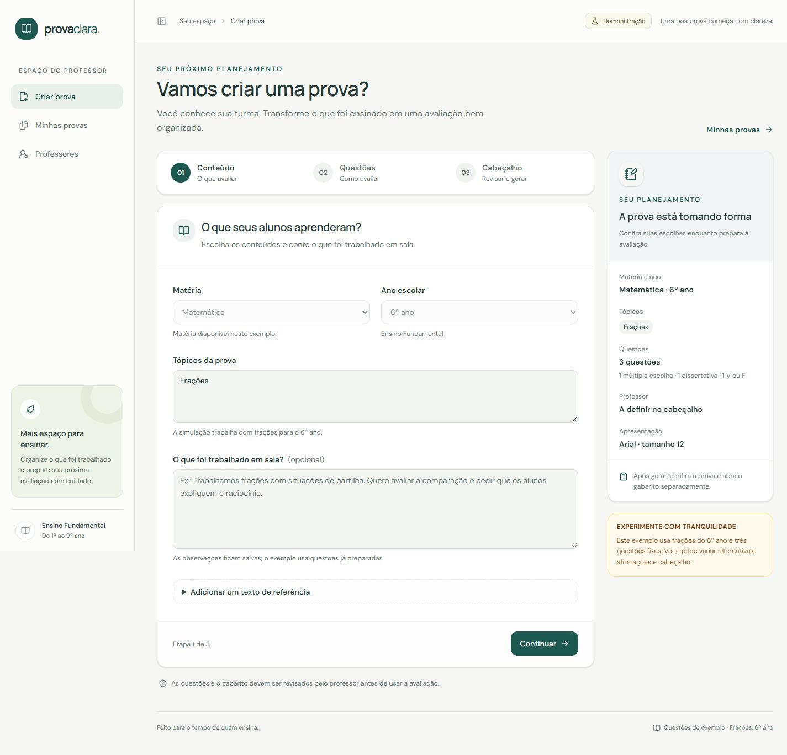
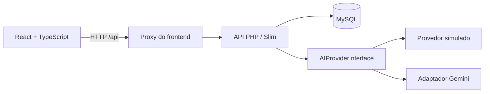

# Prova Clara

Aplicação para preparar avaliações escolares do **1º ao 9º ano do Ensino Fundamental**, com configuração de questões, cabeçalho personalizado, gabarito separado e histórico de gerações.

O projeto reúne um frontend em **React + TypeScript** e uma API em **PHP + Slim**, organizados no mesmo repositório. O backend consulta dados curriculares da BNCC e utiliza um contrato de provedores para alternar entre geração simulada e integração com IA.



## Experimente em poucos minutos

**Pré-requisito:** Docker com Compose v2. No Windows, utilize o Docker Desktop com containers Linux.

Na raiz do projeto:

```bash
docker compose -f compose.demo.yaml --profile frontend up --build -d --wait --wait-timeout 120 web
```

| Serviço | Endereço |
|---|---|
| Aplicação | [localhost:5173](http://localhost:5173) |
| Swagger da API demo | [localhost:8081/docs](http://localhost:8081/docs) |
| Contrato OpenAPI | [localhost:8081/openapi.json](http://localhost:8081/openapi.json) |

**A demonstração funciona sem arquivo `.env`, chave de IA ou instalação local de PHP, Composer, Node.js e MySQL.** O Docker instala as dependências e prepara o banco.

O cenário demo usa currículo sintético e questões fixas de **frações para o 6º ano**, com três questões: múltipla escolha, dissertativa e verdadeiro ou falso. É possível variar alternativas, afirmações e cabeçalho. Os textos livres ficam registrados, mas o provedor simulado não os interpreta.

Para conhecer o fluxo:

1. Crie uma conta na tela **Cadastre-se** e entre na aplicação. A demonstração também exige uma sessão válida.
2. Em **Professores**, cadastre um nome e salve escola e preferências de fonte.
3. Em **Criar prova**, avance pelas etapas de conteúdo, questões e cabeçalho.
4. Selecione o professor e clique em **Gerar prova**.
5. Leia a avaliação, consulte **Ver gabarito** e acesse **Minhas provas** para o histórico.

Para encerrar:

```bash
docker compose -f compose.demo.yaml --profile frontend down
```

O banco demo é temporário: seus cadastros e provas são descartados quando o MySQL desse ambiente é parado. O ambiente principal utiliza volumes persistentes separados.

## Funcionalidades

- Cadastro, login e logout validados pela API, com sessões HttpOnly e proteção CSRF.
- Cadastros, provas e gabaritos separados por usuário, com manutenção curricular restrita a administradores.
- Criação de provas em três etapas, com resumo das configurações.
- Distribuição automática ou manual entre três tipos de questão.
- Quantidades configuráveis de alternativas e afirmações de verdadeiro ou falso.
- Cadastro de professores, escola e preferências de apresentação.
- Cabeçalho e fonte preservados na prova, mesmo após editar o professor.
- Leitura de provas e consulta do gabarito em telas separadas.
- Histórico paginado de sucessos, falhas e tentativas em andamento.
- Importação de PDF curricular, extração por página, estruturação e revisão da BNCC pela API.
- Tela de revisão da BNCC e liberação por matéria e ano escolar, com proteção dos itens já publicados.
- Contexto curricular selecionado por matéria, ano e tópicos.
- Validação estrutural da resposta e conferência das referências curriculares.
- Cotas e limites de concorrência de gerações e processamento de somente um PDF por vez.
- Swagger UI local com as **35 operações da API** documentadas, incluindo autenticação.

## Tecnologias

| Camada | Tecnologias |
|---|---|
| Frontend | React, TypeScript, Vite, Tailwind CSS, shadcn/ui |
| Navegação e dados | React Router, TanStack Query |
| Backend | PHP 8.4, Slim 4, Medoo, FrankenPHP em modo clássico |
| Dados | MySQL 8.4, migrations e seeds com Phinx |
| IA | `AIProviderInterface`, `FakeAIProvider` e adaptador Gemini |
| Documentos | Poppler para extração de texto e layout de PDFs |
| Contratos | OpenAPI 3.1, JSON Schema e tipos TypeScript gerados |
| Testes | PHPUnit, Vitest e React Testing Library |
| Execução | Docker Compose e Nginx para servir o frontend |

## Arquitetura e decisões



O frontend concentra navegação, formulários e apresentação. A API centraliza regras, persistência, consulta curricular e comunicação com os provedores.

- **Responsabilidades separadas:** Actions recebem HTTP, serviços coordenam os casos de uso e repositories acessam o banco.
- **Provedores substituíveis:** a geração depende de uma interface, permitindo exercitar o fluxo completo com o fake.
- **Contexto rastreável:** habilidades e competências recuperadas do MySQL incluem referências às páginas de origem. A consulta atual é estruturada e lexical.
- **Resposta validada:** o backend confere o JSON, as configurações solicitadas e os códigos BNCC, além de reconsultar a revisão curricular após a geração.
- **Persistência consistente:** prova, gabarito e sucesso no histórico são confirmados juntos. A chamada à IA ocorre sem manter uma transação aberta.
- **Apresentação determinística:** cabeçalho e fonte são preenchidos pelo backend; esses campos não precisam ser enviados à IA.
- **Contratos compartilhados:** os tipos da API no frontend são gerados a partir do OpenAPI.
- **Geração explícita:** o frontend não repete automaticamente o POST de geração, evitando duplicação em uma nova tentativa de rede.
- **Identidade verificada no servidor:** sessão opaca com hash no banco, cookie HttpOnly, validação de CSRF/origem/Host e consultas filtradas pelo proprietário.
- **Contenção de recursos:** cotas de IA coordenadas pelo MySQL, lock global para PDFs e limites de memória/CPU do extrator e do container.
- **Execução reproduzível:** dependências registradas nos lockfiles e ambientes separados para desenvolvimento, demonstração e testes.

## Organização do repositório

```text
frontend/
  src/
    app/                 navegação e estrutura da aplicação
    components/          componentes compartilhados e shadcn/ui
    features/            provas, professores e histórico
    lib/api/             cliente HTTP e tipos do OpenAPI
  nginx/                 servidor estático e proxy
src/
  Application/           serviços, contratos e validações
  Infrastructure/        provedores, documentos e persistência
  Http/                  Actions, respostas e OpenAPI
config/                  bootstrap, rotas e configurações
database/                migrations e catálogos iniciais
tests/                   testes unitários e de integração do backend
examples/                exemplos executáveis e cenário demo
docs/screenshots/        imagens da interface
```

## Testes e build

Na última verificação registrada, passaram **623 testes do backend (2.580 verificações)** e **51 testes do frontend**, e o build TypeScript/Vite concluiu. Os testes cobrem autenticação, isolamento entre contas, CSRF, permissões administrativas, cotas e concorrência. Cadastro e revogação da sessão foram conferidos por HTTP; login, recarga da página, consulta curricular como professor e logout foram conferidos no navegador. O fluxo anterior de geração com o provedor simulado continua coberto.

### Backend

Na raiz, execute a suíte com MySQL descartável:

```bash
docker compose -f compose.test.yaml up --build --abort-on-container-exit --exit-code-from tests
docker compose -f compose.test.yaml down
```

Os testes incluem contratos dos provedores, erros HTTP, schema da prova, migrations, processamento de PDFs, seleção curricular, alterações durante a geração, transações e histórico. Eles não fazem chamadas reais ao Google.

### Frontend

Para executar ferramentas fora do Docker, utilize Node.js 22.12 ou superior compatível com as dependências:

```bash
cd frontend
npm ci
npm test
npm run build
```

Os testes verificam validação dos formulários, composição do pedido, erros de integração, preferências legadas, prevenção de clique duplo e consulta do gabarito somente após ação explícita.

## Desenvolvimento do frontend

O frontend utiliza por padrão a API principal em `http://127.0.0.1:8080`. Prepare esse ambiente conforme a seção seguinte e execute:

```bash
docker compose up --build -d --wait --wait-timeout 120 app
```

Em outro terminal:

```bash
cd frontend
npm ci
npm run dev
```

O Vite utiliza a porta 5173 e encaminha `/api` para o backend principal. Encerre o frontend Docker antes de iniciar o Vite na mesma porta:

```bash
docker compose -f compose.yaml -f compose.frontend.yaml stop web
```

Para desenvolver com a simulação, inicie a API de `compose.demo.yaml` e configure `VITE_API_MODE=demo` e `API_PROXY_TARGET=http://127.0.0.1:8081` no `.env.local` do frontend. A demonstração Docker continua explicitamente configurada como `demo`. Para outras opções, utilize `frontend/.env.example` como referência. Chaves de IA e senhas pertencem ao backend.

Para atualizar os tipos após alterar o contrato, com a API principal em execução:

```bash
cd frontend
npm run api:types
```

Os tipos gerados já estão versionados; uma compilação normal não depende dessa atualização.

## Ambiente principal e integração real

O ambiente principal usa `compose.yaml`, volumes persistentes e configurações locais. Crie seu `.env` a partir de `.env.example`, caso ele ainda não exista, e preencha `DB_PASSWORD` e `MYSQL_ROOT_PASSWORD` com valores diferentes.

Para iniciar a API e preparar o banco:

```bash
docker compose up --build -d --wait --wait-timeout 120
docker compose exec app composer db:migrate
docker compose exec app composer db:seed
```

O seed cadastra matérias e anos escolares; ele não importa nem aprova a BNCC.

Para servir também o frontend conectado à API principal, encerre o frontend demo para liberar a porta 5173 e execute:

```bash
docker compose -f compose.demo.yaml --profile frontend stop web
docker compose -f compose.yaml -f compose.frontend.yaml up --build -d --wait --wait-timeout 120 web
```

Cadastre sua conta pela interface. O cadastro público cria um professor; a promoção a administrador é explícita, pelo terminal da instalação:

```bash
docker compose exec app php bin/promote-admin.php seu-email@example.com
```

Com uma conta administrativa, acesse **BNCC** no menu para selecionar o documento, a matéria e o ano. Confira as habilidades e competências com as páginas de origem, registre as decisões e utilize **Liberar matéria e ano** quando todos os itens dessa combinação estiverem aprovados. Outros conteúdos podem continuar pendentes. As competências compartilhadas e as habilidades utilizadas por uma liberação ficam protegidas contra edição; correções posteriores exigem uma nova revisão do documento.

Contas comuns podem consultar o currículo e gerar suas provas. Somente administradores podem importar o PDF de regras, revisar e liberar conteúdo. Dados privados antigos ficam preservados sem proprietário e invisíveis até atribuição explícita pelo comando `bin/claim-legacy-data.php --email=...`; o primeiro cadastro não os recebe automaticamente.

A geração real exige a combinação curricular liberada e `GEMINI_API_KEY` configurada no `.env` do backend. Após alterar a configuração, recrie o serviço `app`. O primeiro teste com chave real continua pendente.

## Acesso e limites

A API mantém sessões de 12 horas em cookie HttpOnly e SameSite Strict. O frontend consulta `GET /auth/session` e mantém apenas o token CSRF em memória; não armazena JWT ou credencial de sessão em `localStorage`. Login, cadastro e logout ficam no grupo **Autenticação** do Swagger, que acrescenta CSRF automaticamente nas escritas.

Por padrão, são permitidas 20 admissões de geração por conta e 100 para toda a instalação por dia UTC, intervalo mínimo de dez segundos, uma geração simultânea por conta e duas no total. Falhas após a admissão continuam contabilizadas. Esses limites controlam chamadas e concorrência; não representam um orçamento monetário.

O processamento de PDFs exige administrador, aceita um arquivo por envio e executa uma operação por vez. A API roda sem root, com recursos limitados e proteção de filesystem; o parser nativo também possui teto próprio de memória e CPU. Hosts e origens locais são limitados por configuração. Uma implantação HTTPS deve definir `AUTH_COOKIE_SECURE=true` e suas listas explícitas de hosts/origens.

## Estado atual e limites

Este é um **MVP de desenvolvimento local**. A demonstração permite avaliar o fluxo completo sem contratar um provedor de IA.

- O adaptador Gemini está implementado e coberto por testes com respostas HTTP simuladas; chamadas reais ainda não foram validadas.
- O conteúdo oficial da BNCC não acompanha o repositório. A estruturação atual utiliza um perfil para uma cópia específica do documento; outros PDFs exigem um perfil compatível.
- A validação de referências não certifica, por si só, a adequação pedagógica das questões nem a correção semântica das respostas. A revisão do professor continua necessária.
- Cadastro/login e permissões estão implementados. Recuperação de senha, verificação de e-mail e MFA ficam para etapas posteriores.
- Upload de prova PDF como referência, geração de imagens e exportação final em PDF ficam para etapas posteriores.
- Avisos de segurança de componentes nativos e bibliotecas incorporadas ao Swagger exigem acompanhamento separado dos audits dos lockfiles. Sua exploração não foi demonstrada no fluxo atual; esta etapa de autenticação não atualiza esses componentes automaticamente.

Os arquivos `.env` reais, dados locais, dependências instaladas e builds não são versionados. Os dois arquivos `.env.example` contêm somente configurações de exemplo, sem chaves ou senhas reais.

## Componentes e licenças

Os avisos de componentes e fontes ficam em [THIRD_PARTY_NOTICES.md](frontend/THIRD_PARTY_NOTICES.md). As licenças distribuídas com o frontend estão em `frontend/public/licenses/`; o Swagger UI e a fixture do OpenAPI mantêm suas licenças e referências de origem.
